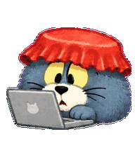

<div align="center">

# 🥤 瓶盖汤姆

**上班搭子，摸鱼同伙。**


红瓶盖，半眯眼，一点心虚。<br>
把打工人的日常，装进一只 Codex 桌面宠物。

[](https://github.com/LJjayyy/bottle-cap-tom)


[](https://petdex.dev/pets/bottle-cap-tom)

[**在 Petdex 安装 ↗**](https://petdex.dev/pets/bottle-cap-tom) · [下载 ZIP](https://github.com/LJjayyy/bottle-cap-tom/releases/latest/download/bottle-cap-tom.zip) · [安装说明](#安装) · [互动说明](#互动说明)

</div>

---

## 今日工位实况

<table>
  <tr>
    <th align="center">📱 老板不在</th>
    <th align="center">👀 老板来了</th>
    <th align="center">💻 收到，马上做</th>
  </tr>
  <tr>
    <td align="center"></td>
    <td align="center"></td>
    <td align="center"></td>
  </tr>
  <tr>
    <td align="center">刷刷手机，眨眨眼<br>抬头确认一下环境</td>
    <td align="center">手机一藏，小爪归位<br>我一直都很认真</td>
    <td align="center">电脑在左前方<br>小爪敲几下键盘</td>
  </tr>
</table>

手绘质感的蓝灰汤姆猫，戴着一顶红色可乐瓶盖。保留圆滚滚的轮廓、奶油色口鼻和熟悉的委屈眼神，让摸鱼和装忙都看得清楚。

## 安装

### 方式一：通过 Petdex 安装（推荐）

瓶盖汤姆已通过 Petdex 审核，正式上架为 **No. 5143**。打开 [Petdex 宠物主页](https://petdex.dev/pets/bottle-cap-tom)，按页面指引安装；已安装 Node.js 的用户也可以在终端运行：

```bash
npx petdex@latest install bottle-cap-tom
```

安装完成后，在 Codex 的宠物设置中刷新并选择「瓶盖汤姆」，输入 `/pet` 显示宠物。具体菜单名称以客户端为准。

### 方式二：手动下载 ZIP

1. 下载 [最新宠物包 `bottle-cap-tom.zip`](https://github.com/LJjayyy/bottle-cap-tom/releases/latest/download/bottle-cap-tom.zip)。
2. 解压到 `~/.codex/pets/bottle-cap-tom/`，确保文件结构如下：

   ```text
   ~/.codex/pets/bottle-cap-tom/
   ├── pet.json
   └── spritesheet.webp
   ```

3. 打开 Codex 的宠物设置，刷新列表并选择「瓶盖汤姆」。菜单名称可能随客户端版本变化。

<details>
<summary>macOS / Linux：终端安装</summary>

下载完成后，执行以下命令。若下载文件不在「下载」目录，请调整 ZIP 路径。

```bash
mkdir -p "$HOME/.codex/pets/bottle-cap-tom"
unzip -o "$HOME/Downloads/bottle-cap-tom.zip" \
  -d "$HOME/.codex/pets/bottle-cap-tom"
```

已有同名本地宠物时会覆盖其文件，建议先备份旧版本。

</details>

如果客户端当前选择的是账号云端副本，替换本地文件不会自动更新那个副本；需要同步更新云端素材，再选择对应宠物。

## 互动说明

| 情况 | 汤姆的表现 |
| :--- | :--- |
| 空闲 | 躲在笔记本后面刷手机，偷笑、眨眼，偶尔抬眼瞄一眼 |
| 鼠标移入身体 | 瞪眼露馅，藏起手机，双爪装忙，再心虚偷瞄 |
| 客户端触发工作状态 | 三分之四侧身，面对左前方的电脑，小爪敲键盘 |
| 其他原生状态 | 保留移动、招手、失败、等待和检查动作 |
| 视线方向 | 提供 16 个方向的素材，具体触发由客户端决定 |

**工作动画会回到摸鱼。** 在本次验证的 Codex 客户端中，工作动作约播放 2.46 秒后回到空闲；鼠标移入反应约 2.52 秒。回到摸鱼不代表任务结束，宠物也不独立判断你是否正在工作。

<details>
<summary>看看实际节奏：认真一会儿，然后继续摸鱼</summary>

<p align="center">
  
</p>

此预览模拟验证时的客户端节奏。上方三张单状态动图为了方便观察会循环播放，不能据此推断客户端会持续播放某个动作。其他客户端或版本的调度可能不同。

</details>

宠物保留 Codex 原生互动，没有修改应用程序。普通鼠标绕着宠物移动时，不保证触发持续的视线跟随；悬停也是通用反应入口，不会判断汤姆刚才是否在摸鱼。

## 包里有什么

| 内容 | 规格 |
| :--- | :--- |
| 精灵图 | 1536 × 2288，透明 WebP |
| 布局 | v2，8 列 × 11 行，单格 192 × 208 |
| 动画 | 9 组标准状态 |
| 视线 | 16 个方向，另有专用正面帧 |
| 元数据 | `pet.json`，宠物 ID 为 `bottle-cap-tom` |

`assets/` 是 README 展示用的 GIF；安装宠物只需要根目录中的两个文件。

本仓库收录的是更新02素材：新版摸鱼待机、被发现的悬停反应，以及修正后的工作姿势。已在 [Petdex 正式上架](https://petdex.dev/pets/bottle-cap-tom)，可从 Petdex 安装，也可以使用本仓库的 Release 安装包。

## 创作说明

这是基于 Tom / 汤姆猫形象的非官方同人宠物，与原角色权利人及 OpenAI 无隶属或合作关系。第三方角色权利归相应权利人所有。

素材以「保留所有权利」方式发布；本仓库没有授予额外的商用或再分发许可。详见 [使用与权利说明](LICENSE.md)。

---

<div align="center">
  <sub>电脑要敲，手机也要刷。瓶盖不能掉。</sub>
</div>
